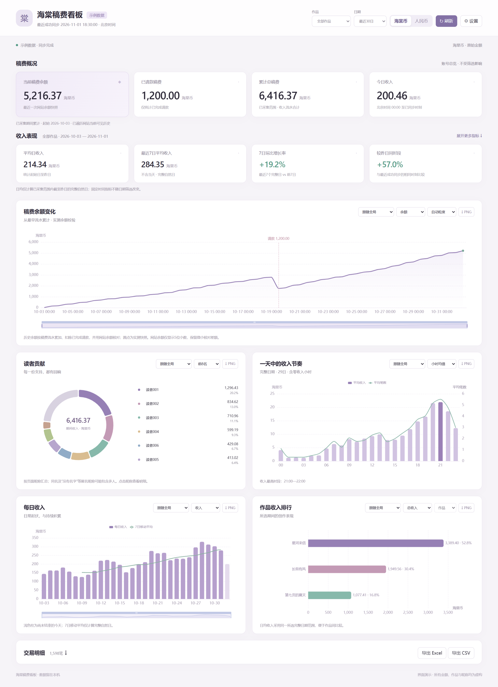

# 海棠稿费看板

供个人使用的 Windows 本地稿费看板，读取海棠账号的稿费与请款记录，展示余额、收入表现、读者贡献和作品排行。



## 下载与启动

### 1. 下载源码

点击仓库页面的 **Code → Download ZIP**，下载后完整解压到一个固定文件夹。不要直接在压缩包里运行。

### 2. 安装运行工具

- Windows 10/11 64位，已安装 Microsoft Edge 或 Google Chrome 稳定版。
- 安装 [uv](https://docs.astral.sh/uv/getting-started/installation/)，安装后重新打开终端或资源管理器。
- 安装 [Microsoft Edge WebView2 Runtime](https://developer.microsoft.com/microsoft-edge/webview2/)，已有该组件时无需重复安装。

不需要预先安装 Python、Node.js 或 Excel。uv 会为项目准备 Python 3.13 和独立依赖环境。

### 3. 启动

双击解压目录里的 **start.cmd**。

首次运行会下载 Python（如缺失）、项目依赖，需要联网并等待数分钟。采集直接使用系统已有的Edge或Chrome，不额外下载浏览器。

准备完成后会自动打开独立看板窗口。之后仍双击 `start.cmd` 启动。

### 4. 首次登录

点击 **登录海棠并同步**，在弹出的系统浏览器专用窗口中自行输入账号、密码和验证码。进入稿费页后自动开始同步，完成后登录窗口关闭。

后续启动会复用登录状态，先显示已有数据，再后台同步；登录失效时重新登录即可。

## 常用操作

- 顶部可筛选作品、日期，并切换海棠币／人民币。账号财务卡片保持总览口径。
- 每张图可单独选择作品；余额主图支持累计收入切换、1小时至1日粒度及缩放。
- 历史余额按最早流水累计，收入增加、已完成请款扣减，并用网站余额核对。
- 点击读者昵称查看明细；展开交易明细后可分页浏览。
- Excel、CSV和各图表PNG保存到本机数据目录的 `exports`，可在 **设置 → 打开导出目录** 查看。
- 默认每5分钟同步，可在设置中选择1、5、15、30分钟或关闭。需要核对全部历史时使用 **完整重新核对**。
- 关闭主窗口即退出，不开机自启、不在托盘常驻。

## 数据与统计

数据目录为 `%LOCALAPPDATA%\HaitangDashboard`，包含数据库、专用浏览器登录状态、备份、导出和日志。每日首次成功同步自动备份，保留最近30份；设置中支持备份与恢复。

- 时间统一按北京时间处理；网站未附时区，默认按UTC+8解读，可在设置中确认。
- 累计稿费按已采集收入明细计算，显示覆盖起点；不以余额加请款替代。
- 日均与7日均排除当天，完整日期内没有收入的日期计零。
- 作品与章节按网站实际名称归属；无法识别的收入仍计入账号总收入。
- 按约定 **1海棠币＝1TWD**，人民币按最新参考TWD/CNY汇率估值，不代表实际提现到账。
- 汇率来自 [FloatRates](https://www.floatrates.com/json-feeds.html)，缓存12小时；失败时保留旧值及数据时间，没有可用汇率时仅显示海棠币。

本程序仅用于同一数据目录下的单个海棠账号。网站改版、历史记录缺失或作品改名可能需要重新核对；无法核对历史余额时暂显示实测快照。

## 无法启动或同步

- **首次下载失败**：检查网络后重新运行 `start.cmd`，控制台会保留错误信息。
- **窗口未打开**：检查WebView2 Runtime及Windows更新，查看数据目录下的 `logs/startup.log`。
- **登录过期**：在看板中重新登录。
- **断网或网站暂不可用**：仍可查看已有统计，恢复后点击刷新。

## 手动启动

在解压目录打开PowerShell：

```powershell
uv sync --locked --managed-python
.\.venv\Scripts\python.exe -m app.browser
.\.venv\Scripts\python.exe launcher.py
```

程序只读取稿费与请款记录，不执行请款、购买或作品修改。请遵守网站使用规则，不要把同步频率设置得过高。

## 主要组件

Python、pywebview／WebView2、FastAPI、Playwright、SQLite、openpyxl，以及随项目提供的 [Apache ECharts](https://echarts.apache.org/) 本地资源。ECharts的Apache-2.0许可证位于 `app/frontend/vendor/ECHARTS-LICENSE.txt`。

## 系统浏览器兼容性

默认跟随Windows的默认浏览器（支持已安装的Chrome／Edge）。默认浏览器为Firefox等其他浏览器、或无法识别时，请在看板设置中选择已有的Chrome或Edge；不会擅自改变系统默认浏览器。浏览器程序沿用系统安装和更新；看板仅使用独立的登录配置目录，不占用日常浏览器配置。切换浏览器后可能需要重新登录海棠。

使用Playwright官方的`msedge`/`chrome`稳定频道，不固定浏览器版本或复制浏览器程序。没有兼容浏览器时明确提示，不自动下载替代浏览器。浏览器未来升级如发生协议或企业策略变化，需要更新看板的Playwright版本并验证，不能保证任意未来版本始终兼容。

在 **设置 → 登录与采集浏览器** 可选择跟随系统默认、Google Chrome或Microsoft Edge；选择仅保存在当前用户数据目录，不随源码包发布。看板主界面始终为独立窗口，关闭即停止同步。

高级用法：需要临时指定Chrome时，可在PowerShell中设置 `$env:HAITANG_BROWSER='chrome'` 后运行；指定Edge使用 `msedge`，未配置时为 `auto`，跟随系统默认；环境变量优先于看板内设置。
